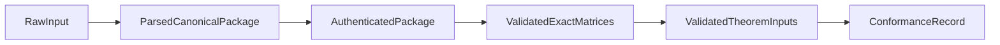

# Mojo architecture

## Role

Mojo is a required independently implemented native conformance route for Phase 1. It consumes the
same original body and envelope bytes as Rust and independently reproduces:

- canonical parsing decisions;
- domain-separated SHA-256 digests;
- normalized exact rational-complex semantics;
- exact Hermiticity and theorem-input validation;
- deterministic first-failure classification; and
- canonical conformance records.

Mojo does not execute Lean theorem declarations, emit the authoritative result, or establish
scientific admission. Missing or failing Mojo conformance prevents Lean acceptance. Mojo must not
call the Rust parser/checker, import Rust-produced semantic objects, or treat a Rust record as its
input.

## Planned source layout

```text
mojo/
├── pyproject.toml
├── uv.lock
├── src/
└── tests/
```

The exact Mojo package version, target platform, installation source, resolved artifact checksum, and
locked environment must be recorded. Virtual environments and compiler caches are generated state
and must remain ignored.

## Capability gate

The external 2026-11-08 Gate 0 probe established:

1. checked byte I/O and end-of-file behavior;
2. fixed-width overflow behavior;
3. an independently reviewable SHA-256 route;
4. arbitrary-precision signed integer support;
5. normalized exact rational arithmetic;
6. exact rational-complex equality and conjugation;
7. deterministic bounded allocation and the frozen `6*n*n` normalized-operation schedule;
8. deterministic binaries and tests on the pinned platform;
9. available format, lint, test, and package-audit commands; and
10. an implementation route that does not use Rust FFI or Rust-produced intermediates.

The qualified routes are source-built Decimo BigInt/Rational and an independently authored
pure-Mojo SHA-256 implementation. `FileHandle.read_bytes()` is the qualified arbitrary-byte route;
text-decoding `FileHandle.read()` is rejected. Mojo fixed-width `Int` wraps, so future checker size,
schedule, allocation, and index arithmetic must be explicitly guarded.

Mojo may not be silently demoted to an optional or shadow route: changing its mandatory status
requires an explicit architecture revision. FFI to Rust does not satisfy independence. Any future
failure to preserve the qualified exact-arithmetic, raw-byte, SHA-256, or checked-boundary route must
stop Phase 1 for review.

## Type-state boundary

Mojo should mirror semantic states, not Rust implementation details:



A passing conformance record must not be constructible from raw, merely parsed, or unauthenticated
input. `ACCEPTED_EXACT_BINDING` is not a Mojo type or Mojo output.

## Required quality gates

Gate 0 froze locally passing capability-probe commands for `mblack`, `mojo format`, warnings-as-errors
builds, selected Decimo tests, dependency/license inspection, raw-byte bounds, exact arithmetic,
SHA-256 vectors, and deterministic compiler output.

Before the mandatory Mojo route can participate in an accepted result, the separately authorized
implementation must additionally freeze passing commands for:

- unit tests for the actual checker;
- bounded adversarial parser testing;
- canonical fixture and mutation-corpus reproduction;
- deterministic conformance-record serialization; and
- byte-for-byte differential comparison with Lean and Rust.

## Current status

No `mojo/` source root or checker exists. The external 2026-11-08 Gate 0 workspace qualified Mojo
1.2.0 on Apple ARM64 from two checksum-pinned official wheels, a complete seven-wheel offline
formatter environment, source-built Decimo 0.16.0 at immutable commit
`c49b209ae9d115372b1d76f39ab414f073e8df3a`, and an independent pure-Mojo SHA-256 capability route.
See the [Mojo installation guide](../../user-guide/installation/mojo/index.md).

Official wheels, `.mojoc`, MAX runtime files, and compiled Mojo binaries remain local-only and
non-redistributable under the source-only distribution model. The external capability probes are not
repository implementation. Adding Mojo or Decimo source, constraints, or lock data requires separate
authorization.
