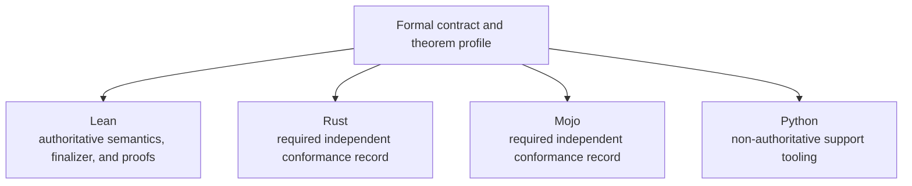

# Repository layout

## Current authoritative layout

```text
projectkoios-formal/
├── ProjectKoios/                 # Lean source tree
├── ProjectKoios.lean             # narrow Lake package root
├── proofs/                       # human-readable theorem dossiers
├── specification/               # source-neutral normative certificate schemas
├── docs/                         # policy, crosswalk, plan, and architecture documents
├── scripts/                      # audit and immutable-pin checks
├── src/python/projectkoios/formal/documents/
│   └── proofs/                   # non-authoritative proof-compendium builder
├── lakefile.toml                 # Lake package definition and dependency revision
├── lake-manifest.json            # resolved Lake dependency graph
├── lean-toolchain                # Lean toolchain pin
└── AGENTS.md                     # repository authority and operating rules
```

The existing Lean build and audit entry points are:

```text
lake build
./scripts/check-pins.py
./scripts/audit.sh
python3 src/python/projectkoios/formal/documents/proofs/compendium.py
```

## Planned polyglot additions

```text
projectkoios-formal/
├── rust/
│   ├── Cargo.toml                # planned Rust package or workspace manifest
│   ├── Cargo.lock                # committed locked dependency resolution
│   ├── rust-toolchain.toml       # committed exact toolchain version and target
│   ├── src/                      # Rust conformance implementation
│   └── tests/                    # Rust conformance and adversarial tests
├── mojo/
│   ├── pyproject.toml            # planned exact Mojo package constraint
│   ├── uv.lock                   # committed locked environment resolution
│   ├── src/                      # Mojo conformance implementation
│   └── tests/                    # Mojo conformance and adversarial tests
└── fixtures/
    └── exact-direct-matrix/      # planned versioned synthetic canonical/adversarial bytes
```

The Rust, Mojo, and fixture trees are target additions, not existing source roots. Future Python
fixture tooling would extend the existing `src/python/projectkoios/formal/` namespace but remains
separately gated. The normative v2 schema review gate is complete; additions still require the
clean-base gate, dependency review, toolchain authorization, and separate implementation
authorization.

## Why Lean stays under `ProjectKoios/`

The Lake package already uses `ProjectKoios/` as its source root and exposes the
`ProjectKoios.Formal` and `ProjectKoios.BandGauge` namespaces. Moving existing declarations into
`lean/src/` would create an unrelated migration and invalidate established module paths, manifests,
dossiers, and audit tooling. `docs/architecture/lean/` documents the Lean area; it does not imply a
new `lean/src/` source root.

## Ownership and result rules

- Lean owns propositions, original-byte-to-semantics soundness, theorem authority, and the final
  authoritative result.
- Rust and Mojo independently consume the original package bytes and emit conformance records only.
  Neither may emit `ACCEPTED_EXACT_BINDING` by itself.
- Both native records are mandatory. A missing route is unresolved; a malformed, failing, or
  disagreeing route rejects according to the frozen precedence.
- Python may assemble proof documents and, when separately authorized, create and mutate synthetic
  fixtures, but it cannot produce authoritative acceptance.
- Shared fixtures contain only repository-permitted synthetic bytes and expected dispositions.
- Generated build output, virtual environments, caches, and runtime state are ignored and never
  treated as source or evidence.
- No language area may add a daemon, service, registry, telemetry path, credential store, or
  computational-owner adapter.

## Dependency direction



Rust and Mojo depend on the frozen byte contract rather than on each other. Python may invoke
executables in tests for comparison but must not be imported by Lean, Rust, or Mojo checker paths.
Computational repositories interact only through versioned bytes and recorded tool identities.

## Supply-chain records

A lockfile is a resolution record, not proof that a compiler, registry, package, or binary is
immutable or authentic. Before implementation, each non-Lean language area must record:

- exact compiler/interpreter version and target triple;
- installation source and package/registry identity;
- source revision where available;
- downloaded artifact or distribution checksum;
- complete locked dependency graph with checksums or immutable Git revisions;
- dependency licenses and security-review disposition; and
- the commands used to reproduce and verify the environment.

No floating branch, tag, unconstrained package range, or optional unrecorded native library may
enter the accepted checker path. The unavoidable platform baseline must record the operating-system
build, architecture, loader/runtime identity, compiler target, and dynamically linked system-library
inventory for each retained checker binary; static linkage should be used where supported and
reviewed, not assumed to remove all platform trust.

## Acceptance-command registry

The Lean commands and external Gate 0 **capability-probe** commands are frozen from successful local
executions. Architecture documents must not invent implementation commands before those commands run
successfully. The retained external registry records exact working directories, tool paths,
environment variables, expected outputs, exit semantics, and probe hashes.

| Area | Qualified Gate 0 command class | Implementation acceptance command | Status |
|---|---|---|---|
| Lean | `lake build`, pin check, repository audit, audit coverage | certificate finalization `UNFROZEN` | existing harness qualified; finalizer absent |
| Rust | format, Clippy with warnings denied, offline locked test/build, bounded capability probe, deterministic rebuild | parser/checker and conformance commands `UNFROZEN` | environment qualified; implementation absent |
| Mojo | `mblack`, `mojo format`, warnings-as-errors builds, Decimo tests, bounded capability probes, deterministic rebuild | parser/checker and conformance commands `UNFROZEN` | environment qualified; implementation absent |
| Python | package-empty deterministic fixture/mutation capability probe | fixture corpus and orchestration commands `UNFROZEN` | support environment qualified; implementation absent |
| Cross-language | shared standard vectors only | differential and final acceptance commands `UNFROZEN` | normative v2 schema frozen; implementation absent |

## Cross-language completion gate

Before a polyglot implementation can be called complete:

1. toolchains, targets, artifacts, and dependencies are pinned and authenticated as above;
2. each checker parses the same original bytes rather than another route's translation;
3. canonical positive and adversarial fixtures have identical dispositions;
4. semantic matrix digests and exact derived quantities agree byte-for-byte;
5. Lean independently authenticates the original bytes and checks the exact propositions;
6. the authoritative result binds both required native records without a digest cycle;
7. both language-specific command sets and the cross-language command pass; and
8. repository audit and fresh independent review pass.

The independently reviewed and frozen source-neutral v2 schema specifies the two native bindings
and cycle-free lifecycle, but it is not implemented. Step 6 is therefore planned, not an implemented
property.
