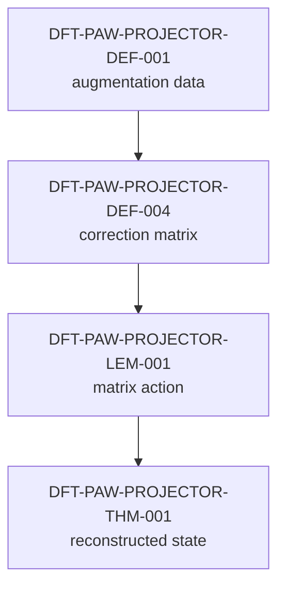

# Lean code standards

These standards apply to repository-owned `.lean` files. They complement Mathlib style, the
repository's [formalization conventions](conventions.md), declaration-ID policy, and authority
boundaries. Their presentation is intentionally compatible with the adopted Physlib and
PhyslibAlpha APIs, while Project Koios retains its own namespace, audit metadata, and stable
declaration IDs. Compatibility does not establish an upstream contribution plan; external ports are
out of scope unless separately reopened and authorized.

## Source documentation

Lean source documentation follows a Lean-native analogue of NumPy docstrings. Use Markdown inside
Lean module docstrings (`/-! ... -/`) and declaration docstrings (`/-- ... -/`). The goal is a
predictable semantic record, not a literal copy of Python syntax and not repetition of information
already visible in a Lean type.

Apply this policy prospectively:

- Every new nontrivial module must have a module docstring.
- Every definition and every new or materially changed public declaration must have a declaration
  docstring. Important existing lemmas should be documented during migration.
- Existing declarations should be migrated when their modules are otherwise changed, prioritizing
  publication-facing definitions, lemmas, and theorems.
- Private implementation helpers may use a short docstring or nearby implementation comment when
  they have no independent mathematical meaning.

Documentation changes do not alter theorem status. The theorem manifest and kernel audit remain the
authorities for declaration and axiom status.

## Module docstrings

Nontrivial mathematical modules use the Physlib-compatible heading structure below:

1. `# Title` followed by a one-line physics or mathematics summary.
2. `## i. Overview` for purpose, ownership, dependency position, the mathematical model, and its
   physical interpretation.
3. `## ii. Key results` listing the principal definitions and results by Lean name.
4. `## iii. Table of contents` listing the lettered sections that follow.
5. `## iv. References` containing verified literature references and repository citekeys.
6. Lettered content sections such as `## A. Definitions`, with nested headings such as
   `### A.1. Supporting identities` when useful.

No heading ends in a full stop. The table of contents must list the lettered sections. Within those
sections, record all proposition-relevant conventions, exact source locators and adaptation
boundaries, genuinely absent hypotheses, and formal scope. A substantive mathematical module also
includes a lettered `Proof schematic` section containing the Mermaid dependency diagram.

Import-only roots and mechanical audit drivers may use a shorter module description because they do
not own a mathematical API.

## Module proof schematics

Every substantive module that owns mathematical declarations must contain one lettered
`## X. Proof schematic` section in its module docstring, where `X` is the appropriate table-of-
contents letter. The section must contain a fenced Mermaid diagram. This requirement
is determined by module ownership and conceptual structure, not by the historical use of Lean's
`theorem` or `lemma` keyword. Import-only namespace roots, mechanical audit drivers, and modules with
no mathematical dependency flow may omit it.

````lean
/-!
# Finite-rank PAW reconstruction

A one-line summary of the finite-rank reconstruction API.

## i. Overview

The overview explains the supplied partial waves, projectors, and reconstruction map.

## ii. Key results

- `FiniteProjectorAugmentation.reconstructState_eq_pseudoState_add_corrections`

## iii. Table of contents

- A. Proof schematic

## iv. References

- Blöchl (1994), DOI `10.1103/PhysRevB.50.17953`.

## A. Proof schematic


-/
````

The diagram is a mathematical dependency schematic, not a tactic trace. Use stable IDs for public
nodes where available. It may group routine helper lemmas rather than drawing every private step, but
it must not invent implications or hide a substantive assumption. Labels should remain readable when
rendered on a portrait compendium page.

The whole-repository proof compendium extracts this Mermaid block from the owning `.lean` module and
places its rendered diagram on the module divider page. Until a module is migrated, the builder may
render an explicitly labeled dossier-inventory fallback; that fallback does not satisfy this source
documentation standard.

## Declaration docstrings

The opening paragraph is mandatory for public declarations. It begins with a one-sentence physics or
mathematics summary. The stable Project Koios declaration ID follows as a separate metadata sentence,
so the mathematical prose remains independent of repository-local audit metadata:

```lean
/--
Exact finite-rank PAW reconstructed-state formula.

Project Koios declaration ID: `DFT-PAW-PROJECTOR-THM-001`.
-/
```

After that summary, use only the sections that add semantic information.

### Mathematical statement

State the mathematical content in conventional notation or a compact formula. Explain how the Lean
statement adapts the source statement when the correspondence is not literal.

### Parameters

Describe the mathematical role of non-obvious explicit parameters. Do not merely repeat their Lean
types. Mention implicit parameters or typeclass arguments only when finiteness, decidable equality,
scalar structure, topology, order, or another instance is mathematically significant.

### Assumptions

Explain named hypotheses and significant typeclass assumptions. Distinguish supplied hypotheses from
conclusions proved in the declaration. State genuinely missing hypotheses when omission limits reuse
or prevents a stronger source claim.

### Conclusion or Value

For a theorem or lemma, explain the conclusion when its significance is not apparent from the
formula. For a definition or construction, use `## Value` to explain what the defined object
represents. Lean declarations do not use a Python-style `Returns` section.

### Conventions

Record declaration-specific sign, normalization, coordinate, action, conjugation, basis, or
index-order conventions. Refer to the module-level convention instead of duplicating it when there is
no declaration-specific refinement.

### Source

For source-bound mathematics, include:

- citekey and bibliographic identity;
- DOI or another stable external identifier when available;
- exact section, theorem, page, or equation locator; and
- the adaptation boundary between the cited statement and the Lean proposition.

A citation documents provenance; it does not establish proof, canonical reference identity, or
scientific validity.

### Scope

State the exact formal scope and meaningful exclusions. Avoid generic boilerplate such as “this is
not a scientific claim” when a more precise statement is available. Prefer concrete language such as
“projector duality is assumed, but completeness and a resolution of identity are not.”

### See also

Link closely related declarations when the relationship is not evident from namespace placement or
the type signature.

### Examples

Examples are appropriate for user-facing constructions, notation, and APIs. Keep them small and use
actual repository declarations. Do not add decorative examples to proof-only supporting lemmas.

## Declaration template

```lean
/--
One-sentence physics or mathematical summary.

Project Koios declaration ID: `FAMILY-THM-001`.

## Mathematical statement

State the formula or proposition and its interpretation.

## Parameters

* `data`: Mathematical role, not merely its Lean type.
* `state`: Meaning of the supplied state or witness.

## Assumptions

* `[Fintype ι]`: Why finiteness is needed.
* `hdual`: Exact property supplied by this hypothesis.

## Conclusion

Explain the result's mathematical significance when needed.

## Conventions

Record declaration-specific coordinate, adjoint, sign, or normalization choices.

## Source

Author and title, citekey, DOI, exact statement locator, and adaptation boundary.

## Scope

State meaningful formal limitations and absent hypotheses.

## See also

* `relatedDeclaration`
-/
```

Delete inapplicable sections. A short supporting identity may need only its mathematical summary, the
stable ID metadata sentence, and one explanatory sentence.

## Declaration and proof presentation

- Use Lean's `lemma` keyword by default.
- Use `theorem` only for a principal result that is well known or presented as a main result in the
  relevant physics or mathematics literature. Public importance, a proof dossier, or audit status
  alone does not justify `theorem`.
- Preserve established local declaration names and stable IDs unless a separately reviewed migration
  authorizes a change. Any future external adaptation is a separate, currently deferred scope and
  may not silently change the local presentation.
- Keep proofs concise. A proof materially longer than roughly 50 lines should be reviewed for
  extraction of independently meaningful lemmas, weaker-hypothesis results, branch lemmas, named
  calculations, or reusable constructions.
- Do not extract trivial rewrites merely to reduce line count.

## Content rules

- Describe semantics and proof boundaries; do not narrate tactic steps.
- Do not restate every binder or duplicate the complete proposition in prose.
- Do not claim a source theorem has been formalized more generally or faithfully than the Lean
  assumptions support.
- Do not hide assumptions, axioms, admissions, unresolved source identities, or certificate
  boundaries in vague language.
- Keep source-neutral algebra documentation free of downstream DFT, PAW, SOC, or publication
  semantics unless the declaration is an explicit binding.
- Use the exact declaration presentation kind: definitions and constructions use `DEF`, supporting
  results use `LEM`, and principal results use `THM`.
- Keep field docstrings on public structure fields even when the enclosing structure has a detailed
  docstring.
- Prefer links to one authoritative module-level explanation over repeated paragraphs in every
  declaration.

## Review checklist

When reviewing a module and its new or materially changed public declarations, verify:

- a substantive mathematical module contains one renderable lettered `Proof schematic` Mermaid
  block listed in the module table of contents;
- the schematic records conceptual mathematical dependencies without implying unsupported proof
  dependencies;
- the stable ID and presentation kind are correct;
- the first sentence states the declaration's mathematical role;
- parameters and assumptions are described semantically where needed;
- proposition-relevant conventions are explicit or linked;
- source-bound claims have exact locators and adaptation boundaries;
- scope language names real limitations rather than generic disclaimers; and
- the documentation does not overstate theorem, evidence, or scientific status.
