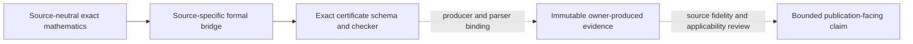
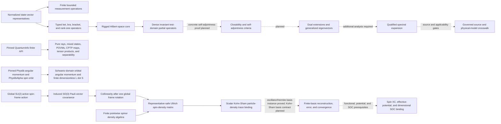

# Formalization roadmap

This roadmap orders work by dependency. It does not authorize implementation, execution, publication, or scientific claims.

## Goal spines

These diagrams show intended direction, not proof status. Solid arrows describe mathematical or
contract flow within a spine; dashed arrows mark planned prerequisites, external evidence flows, or
authority gates. Neither kind of arrow replaces the theorem manifest, a source crosswalk, a checked
certificate, applicability review, or publication authorization. Planned arrows must not be imported
into the generated kernel-dependency graph as though they were Lean implications.

The verification-sidecar spine is:

The current quantum-mechanics direction is:

The manifest records the source-neutral Q0--Q4 layers, a thin finite-dimensional binding to the
pinned `QuantumInfo` pure-ray, mixed-state, POVM, CPTP-channel, tensor-product, partial-trace, and
separability APIs, plus a thin binding to Physlib's three-dimensional Schwartz-domain orbital
angular momentum and PhyslibAlpha's standard spin-half and dimensionless finite `L·S` algebra.
The continuum angular-momentum binding proves symmetry, dense closability, and domain-evaluated
commutation laws but no essential self-adjointness or spectral theorem; the finite spin-orbit
binding does not yet identify a continuum or DFT SOC Hamiltonian. The finite spin-frame layer now
also packages PhyslibAlpha's adjoint matrix as an exact `SU(2) → SO(3)` homomorphism and proves
active covariance of the recovered orbital-valued Pauli coefficients. The finite layer now also
defines collinearity after selecting one common global frame. A representative-safe matrix-valued
`L¹` continuum layer implements almost-everywhere Hermiticity and global collinearity, Ullrich-style
particle and Pauli magnetization traces, particle-density invariance, induced `SO(3)` magnetization
covariance, exact Pauli reconstruction, and occupation-weighted `L²` spinor outer-product
densities. The finite layer includes the exact outer-product difference decomposition, and the
continuum layer now proves representative-safe componentwise, full-matrix, and fixed-occupation
finite-family `L² → L¹` density-error bounds through Mathlib's Hölder map, together with conditional
convergence transfer to the matrix density, particle trace, and all Pauli magnetization components. Finite pointwise spinor density-matrix algebra
remains isolated in the finite-dimensional layer; the continuum module lifts that algebra almost
everywhere without identifying finite and continuum carriers. A thin Kohn--Sham binding
identifies the matrix particle trace with the complexification of the real scalar component-density
sum and proves particle-number identities under explicit normalization and occupation-sum
hypotheses. Explicit finite-index continuum-spinor reconstruction maps now specialize those
bounds and convergence transfers. An idempotent strongly complete projection contract now packages
the exact remaining obligation. A countable Mathlib Hilbert basis now constructs that contract
canonically through finite rank-one partial sums. The proved one-dimensional oscillator/Hermite
family is now packaged as such a Hilbert basis and yields concrete spin-density convergence. The
thin Kohn--Sham layer now transfers this to real scalar `L¹` density convergence and particle-number
integral convergence, including the normalized occupation-sum limit. Exact Parseval/Pythagorean
identities now express orbital truncation errors and particle-number deficits as discarded
coefficient tails, with a full matrix-density tail error budget. Supplied summable global moments
`∑ (k+1)^p |c_k|² ≤ M` now give explicit tail rates `M / (N+1)^p`, matrix-density error bounds,
particle-number deficit bounds, and sufficient cutoff conditions for tolerances. The moment
contracts explicitly require summability; total `tsum` inequalities alone are insufficient. Global
budgets remain independent regularity assumptions in the generic layer, not consequences of finite
retained coefficients. For the one-dimensional oscillator, actual membership in the selected
Hamiltonian closure domain now discharges the global `p=2` contract: the proved coordinate/Parseval
identity derives `∑(k+1)²|c_k|² ≤ 4‖H̄ψ‖²/(ℏω₀)²`. This gives explicit inverse-linear orbital and
full matrix-density error bounds, and an inverse-square particle-number deficit for nonnegative
occupations. Hamiltonian-image norms are not energy expectations. A further domain-valued
partial-sum construction now proves convergence in the explicit sum graph norm and hence
convergence of Physlib quadratic energy values. Nonzero targets give eventual nonzero partial sums
and convergent Rayleigh quotients; for unit-norm domain targets, normalized partial-sum energy
expectations converge as well. Exact discarded-energy identities now give a nonnegative raw
quadratic-energy deficit at most `‖H̄ψ‖²/E_N`. For a unit target with retained squared norm
`r ≥ m > 0`, the normalized energy error is at most
`(‖H̄ψ‖²/E_N + ‖H̄ψ‖ |1-r|)/m`; raw and normalized tolerance-cutoff conditions are explicit.
Early partial sums may vanish, and the retained-norm bound excludes them at a chosen normalized
cutoff. This does not prove a converse domain characterization, numerical norm/tail/energy
certificate, normalized-energy monotonicity, or convergence of a Kohn--Sham total-energy functional.
The existing finite diagonal oscillator Hamiltonian is now bound at scale `ℏω₀` to an explicit
Euclidean coefficient isometry into the actual continuum closure domain: exact intertwining,
adjoint compression, and equal finite/continuum quadratic energies are proved. The `K+1`-coefficient
embedding equals the same domain partial sum used by the approximation layer. This is not a
sampled-grid, quadrature, floating-point, or numerical eigensolver binding. Exact finite residuals
now transport with equal continuum norms. Unit coefficient norm gives a retained exact level within
the residual norm of the trial energy; independently proved residual upper bounds may be used.
A positive gap from the trial energy to every other retained level bounds the orthogonal component
outside a selected eigenstate span, without a phase-fixed vector-error or omitted-tail claim.
The analytic residual and gap inputs are proof hypotheses, not accepted numerical reports. A new
exact rational checker discharges the residual bound for supplied rational component data: it
computes positive mass `S`, checks a maximum squared endpoint sum against `B`, and proves normalized
continuum residual and retained-energy tolerance `sqrt (B/S)`, provided the actual physical scale
`ℏω₀` is separately proved to lie in the proposed interval. Kernel-checked synthetic fixtures cover
acceptance and rejection; runtime parsing, solver-data binding, physical-scale enclosure production,
and gap checking remain deferred. Identifying an
actual Kohn--Sham or numerical basis with an analogous contract remains a separate bridge;
exchange-correlation, effective-potential,
self-consistency, and dimensional SOC bindings remain downstream. The manifest also records
Physlib-backed Q5 domain criteria and essential-self-adjointness sufficient conditions, a first
`SpaceDQuantumSystem` Hamiltonian bridge proving an exact Schwartz domain, symmetry, and
closability under explicit smooth-potential hypotheses, and a singular hydrogenic specialization
proving symmetry and dense closability on Physlib's polynomially bounded Schwartz subdomain. The
continuum harmonic-oscillator bridge further proves exact Schwartz domain, symmetry, closability,
and essential self-adjointness conditional on
density of Physlib's Cartesian eigenstates. It also identifies the legacy and Cartesian
one-dimensional Hilbert carriers and eigenstates. A checked function-level Fourier-integral
injectivity theorem now replaces the integral-form Plancherel premise in the final legacy
completeness step, yielding unconditional one-dimensional eigenstate density and essential
self-adjointness. The self-adjoint closure is now packaged as
`oneDimensionalQuantumSystem` through Physlib's `QuantumSystem.mkESA`. Project Koios now fixes the
generic physical convention `U(t)=exp(-itH/ℏ)` and reparameterizes PhyslibAlpha's `exp(isH)` group
accordingly, including all-time domain-vector derivatives, domain invariance, and Hamiltonian
commutation. The one-dimensional oscillator closure is now bound to PhyslibAlpha's concrete
Cayley-transform domain-aware spectral measure and this physical evolution adapter. The continuum
to scalar-DFT bridge now maps Physlib `L²` orbitals to representative-safe real `L¹` densities,
proves almost-everywhere agreement with the finite pointwise Kohn--Sham density formulas, and binds
those densities to the existing abstract HK/Levy--Lieb variational interface without adding energy
or representability claims. Normalization-dependent integral identities now recover the supplied
occupation sum and the unit-occupation orbital count; normalization, occupation constraints, and
physical filling rules remain explicit rather than inferred. Extending completeness and the
spectral/evolution binding beyond `d = 1` remains planned. No
eigenfunction spectral expansion, textbook-postulate fidelity claim, runtime binding,
or physical-model applicability follows from the arrows alone. Actual compiled dependencies remain
separately documented in
[`audit/declaration-dependency-graph.md`](audit/declaration-dependency-graph.md).

## R0 — repository contract

Status: complete.

- Authority and evidence boundaries.
- Source and dependency identity.
- Module ownership and conventions.
- Theorem manifest, trusted-base audit, and bounded agent workflow.

## R1 — finite foundations

Status: substantially implemented.

- Metric admissible-set geometry.
- Pointwise Bloch sewing and finite rank-two samples.
- Hilbert-ball and weighted Frobenius geometry.
- Rank-two fields, exact canonical band values, exact complex-unitary spectrum/trace/determinant and lower/upper-band invariance, pointwise band-field invariance, unnormalized Frobenius perturbation bound, spectral decomposition, and correlation optimization.
- Exact finite-rank analytic-parent qualification: nonempty finite-bond structure-factor bounds, selected orbital-coordinate bounds, retained/exterior energy bounds, external gap at least `19/10`, and adjacent retained gap at least `7/(10(r-1))`.

Open:

- immutable owner-commit binding for the provisional Periodic2D/3D rank-N formulas and any runtime-array, NumPy, sampled-gap, or scientific applicability bridge;
- periodic-potential construction;
- quotient-torus and regularity contracts;
- concrete publication-data binding; and
- accepted literature identities.

## R2 — rank-two witnesses and certificates

Status: exact scalar geometry and one source construction implemented.

- Reduced spectral and operator losses.
- Ellipse intersection and exact distance.
- Candidate-rectangle containment transfer.
- Rational-center, center-interval, and joint curvature-correlation checkers.
- Exact Paper A two-observation construction and degenerate-curvature regression.

Open:

- runtime parser and artifact binding;
- calculated four-state-parent certificate;
- periodic-potential construction; and
- structured perturbation results beyond scalar boxes.

## R2.5 — finite Fourier and decisions

Status: generic foundations implemented.

- Finite reconstruction, inversion, Parseval, residual tails, Hermitian pairing, fixed-unitary equivariance, exact equal-weight least-squares optimality and uniqueness of support truncation over a complete uniform finite-abelian inventory, and the exact direct partition of matrix Frobenius power into identity-coefficient and nonidentity-coefficient sums, together with an arbitrary-dimension/arbitrary-rank matrix-Frobenius lattice layer and explicit periodic 1-D, 2-D, and 3-D specializations. The power partition specifies exact onsite/nononsite semantics but does not certify subtraction of separately rounded binary64 totals.
- Positive even centered integer inventories, exact negative-Nyquist singleton removal, full-versus-removed reconstruction, normalized removed-block power independent of later range selection, and symmetric ordinary support below half the mesh size.
- Complete finite metric shells over caller-supplied inventories, including nested cutoffs, exact tie retention, conditional inversion and symmetry-orbit closure, strict block-count growth at every attained radius, no-skipped-attained-shell semantics, and exact square, triangular, simple-cubic, and normalized FCC reduced-coordinate indices; no runtime inventory, physical hopping-range, or material binding is inferred.
- Exact integer-lattice quotient admission: `AB=BC` well-definedness certificates on `ℤ³/Bℤ³`, separately admitted inverse maps, two-sided quotient bijectivity, finite positive diagonal quotients, positive cubic FCC--Bain admission, and the fail-closed mixed-modulus criterion `N₂=N₃ ∧ N₁∣N₂`; no runtime mesh or convergence binding is inferred.
- Exact reference/interpolation/conversion/deliberate-truncation residual decomposition with pointwise, finite-maximum, and finite root-mean-square triangle bounds, plus exact Hilbert and explicit matrix-Frobenius power and root-mean-square Fourier-tail identities and pointwise and finite-maximum ambient-norm tail bounds for the deliberate-truncation channel.
- Exact character-phase mode shifts, trivial pointwise scalar-operator conjugation, coefficient separation, pointwise-unitary Frobenius invariance, the finite matrix-product convolution law, the pointwise-unitary triple-convolution support inclusion `supp(Uᴴ A U) ⊆ (-S_U + S_A) + S_U`, and its complete-shell bound `R_A + 2 R_U` for a supplied inversion-invariant subadditive nonnegative radius. Explicit square, triangular, simple-cubic, and normalized FCC integer-lattice radii now square to the existing shell indices and satisfy the required inversion and triangle laws and instantiate the elementwise and complete-shell inclusion bounds; finite-character quotient wraparound remains a separate binding obligation.
- An explicit rank-two `ZMod 2` witness in which a pointwise swap gauge creates the odd coefficient `diag(1/2,-1/2)` and does not commute with zero-mode truncation.
- An arbitrary-finite-dimensional binary product-mesh lift, with explicit 2-D and 3-D cases, in which exact pointwise Hermiticity and ordered-band equality coexist with exact full Fourier reconstruction, zero-mode-truncation noncommutation, and strictly positive omitted matrix-Frobenius power.
- Rectangular complex frames, ambient projectors, compression/reconstruction, and right-unitary retained-coordinate covariance, including the exact dimension-independent construction `F'=F₀G`, `H'=GᴴDG`, complex-spectrum preservation, and known-inverse frame/operator recovery by `Gᴴ`.
- Exact complex-unitary right Procrustes algebra for `‖candidate * gauge - reference‖_F²`, including the cross matrix `candidateᴴ * reference`, Frobenius/trace expansion, polar-witness global minimality, and uniqueness under an explicit positive-definite factor; no runtime SVD, rank, tolerance, or rank-deficient completion is authenticated.
- A finite-mesh Procrustes hierarchy that sums local objectives, lifts one supplied polar witness per point to pointwise and global minimality, requires positive definiteness at every point for summed uniqueness, compares against constant and identity fields, proves exact known-inverse zero-objective controls, and embeds unitary matrices into the abstract identity/global/complete alignment families; no mesh, runtime witness, optimizer, or certificate is authenticated.
- Exact neighbor, sequential, and periodic-seam polar transport from supplied witnesses, including orthonormality and projector preservation, local/seam objective minimality, exact known-gauge recovery and uniqueness, and conditional exact closure when the endpoint is already a known right-unitary gauge of the initial frame. The closure witness is supplied and does not authenticate or distribute an external loop correction.
- An exact orthonormal-frame principal-value bridge: positive-polar-factor eigenvalues lie in `[0,1]`, optimal frame error is `2∑(1-σᵢ)`, projector error is `2∑(1-σᵢ²)`, and the former bounds the latter within a factor of two. No runtime SVD, ordering, rank, or principal-angle array is authenticated.
- Separate singleton, identity, global-unitary, and complete pointwise-unitary alignment families with inclusion-based feasibility transfer and explicit strict-separation witnesses.
- Sewn reference-minus-aligned-candidate operator differences with exact recovery and zero criteria, pointwise self-adjointness closure under complete-space and explicit self-adjointness hypotheses, exact action/operator-norm bounds, and same-alignment subtraction and Lipschitz stability.
- Finite dominance, Pareto efficiency, threshold feasibility, minimum cost, and two-channel classification.
- First-passing existence and uniqueness over supplied finite inventories, including one-cutoff joint passage without monotonicity.
- A generic finite spectral--operator compatibility schema with one common candidate, a nonempty alignment family, and an alignment-infimum operator criterion, a stronger one-alignment witness predicate across mandatory operator channels, explicit-attainment bridges, finite central admissible sets, attained compatibility distance under nonemptiness, zero-distance/compatibility and positive-distance/incompatibility equivalences, conformant model-class embeddings, and first-compatible-class selection.
- An exact finite-maximum aligned-operator loss with same-alignment perturbation and budget-headroom bounds, plus an adapter that retains an application-supplied alignment carrier while projecting its pointwise unitary field into the generic witness/central compatibility predicates.
- Precise mandatory operator channels: exact `ENNReal` error values with channel-specific upper budgets, separately typed nonnumeric structural requirements, and a tagged same-candidate/same-alignment adapter into the generic schema.
- A narrow source-neutral four-stage residual adapter with interpolation, conversion, deliberate-truncation, and total finite-maximum error channels, including coordinatewise budget-relaxation monotonicity, explicit component-to-total budget synthesis under a stated total-headroom premise, exact component-level expansions of conformant operator witnesses and witness compatibility, and disjoint composition with consumer-supplied precise error and structural datasets; the narrow adapter carries an empty structural inventory, while composition preserves added obligations without claiming complete study coverage.
- Exact minimizer existence for nonempty finite alignment families, conversion of infimum passage to a concrete budget-feasible alignment, and conditional central/witness compatibility equivalence under a separate minimizer-channel-conformance premise.
- Exact Boolean dominance, threshold, and nondominated-mask checks.
- Conservative accepted/rejected/unresolved checks for outward interval thresholds, joint feasibility at one decision, and first passage over a supplied finite inventory.

Open:

- owner-specific retained-frame, alignment, self-adjointness-hypothesis, and exact/outward operator-norm binding;
- exact or independently checked construction of application-specific Procrustes polar witnesses, with rank-deficient completion policy kept external unless a consumer freezes it;
- periodic closure-distribution laws and perturbative polar-transport stability under a stated lower singular-value bound;
- authenticated runtime compression/leakage bounds; exact matrix-`L2Operator` and mixed Frobenius/operator frame-compression and projector-sandwich bounds, separate maximum/RMS ordered-spectrum compression transfer, an exact reproduction residual and its orthonormal invariant-range criterion, and a frame-plus-projector bound relative to a zero-residual reference are implemented, but runtime frames and projectors remain unauthenticated;
- authenticated runtime use of the implemented general-rank Hermitian Hoffman--Wielandt square-sum and dimension-normalized RMS/Frobenius bounds; the exact canonical carrier, separate maximum/RMS errors, maximum-form Weyl bound, and RMS compression transfer are implemented, but runtime matrices and eigensolver outputs remain unauthenticated;
- matrix-Frobenius maximum-tail specialization after selecting an explicit representation bridge;
- runtime interpolation, evaluation-mesh, and exact/outward-rounded residual-channel bindings;
- an exact owner-specific bridge from NumPy `fft`/`fftshift` and its centered-origin phase convention to the abstract centered inventory and coefficient field;
- source-defined physical hopping-range, external shell-inventory, and publication-mesh bindings beyond the exact source-neutral metric-shell semantics, including a quotient-compatible bridge from finite character modes and centered representatives to the new integer-lattice radii;
- nonuniform weighted Parseval;
- runtime interval serialization, enclosure-production arguments, and external coverage;
- concrete Paper B/C tables;
- concrete owner-specific error-channel taxonomies and compatibility inventories, verified structural-requirement contracts, heterogeneous candidate-carrier embeddings, cross-gauge stability bridges, and proposition-specific certificate bindings;
- runtime-bound cutoff inventories and later Wannier90 layers, including separate square-unitary, rectangular-isometry, disentanglement, `_u.mat`, `_hr.dat`, and localization semantics;
- quantitative gauge-convolution and omitted-power bounds for gauges without compact finite Fourier support;
- exact twist-gauge conjugacy between uniform-link and seam-localized finite periodic operators;
- exact owner-specific identification of runtime periods, reciprocal-basis coordinates, matrix axes, support, and gauge with the finite-periodic lattice carrier; and
- exact owner-specific identification of a NumPy design with the complete uniform character inventory, plus numerical rank, conditioning, solver, and binary64 route-agreement validation.

The first Ragasa2026b projection proposition is completed as
`BG-PROJECTION-DEF-001` through `011` and `BG-PROJECTION-THM-001` through `008`. The proof
encodes the nearest-neighbor Laurent parent, verifies its scalar square, proves the
source-assumption Laurent square-root obstruction, establishes unit-circle Laurent
uniqueness, verifies the lower-band projector and sandwich identity, and derives the final
matrix-valued non-finite-support conclusion. Later projection questions—quantitative decay,
higher rank, multidimensional parents, and general preservation criteria—remain open.

## R2.6 — implementation applicability and approximate representation bridges

Status: exact cyclic quotient-radius, finite-rank character/fixed-subspace, supplied-witness polar-transport, principal-value frame/projector, matrix-`L2Operator`, mixed Frobenius/operator approximate-compression/projector-mismatch, ordered Hermitian spectral-error carriers, separate maximum-form Weyl and Hoffman--Wielandt RMS bounds, and maximum/RMS ordered-spectrum compression transfer implemented; runtime applicability and closure distribution/stability remain planned.

This stage connects source-neutral finite mathematics to authenticated KSD representations without treating runtime floating-point data as exact by default. The candidate semantic and fail-closed design is recorded in [`BandGauge/ksdft2effmass/authenticated-external-matrix-frame-binding-contract.md`](BandGauge/ksdft2effmass/authenticated-external-matrix-frame-binding-contract.md). Formal-owned [v1 and v2 exact direct-matrix schemas](../specification/certificates/exact-direct-matrix/index.md) now live under `specification/`; KSD motivation and implementation gates remain in the [`pilot plan`](BandGauge/ksdft2effmass/exact-synthetic-direct-matrix-pilot-plan.md); and co-located ownership and layout are recorded in [`architecture/`](architecture/index.md). Version 2 is independently reviewed and frozen, but implementation remains separately gated. None of these documents is an implemented parser, checked certificate, owner adapter, or runtime evidence admission.

Exact finite targets:

- polar closure distribution and lower-singular-value perturbation stability beyond the implemented exact supplied-witness transport and known-gauge uniqueness control;
- authenticated external binding for the implemented general-rank Hermitian Hoffman--Wielandt RMS/Frobenius perturbation and compression-transfer inequalities, without conflating exact mathematics with runtime eigensolver correctness;
- quantitative gauge-tail convolution and omitted-power bounds;
- product-quotient radius and twist-seam conjugacy; and
- claim-driven discrete topology only after orientation, nonzero-overlap, and branch hypotheses are frozen.

Owner-specific bridges:

- centered FFT origin, sign, normalization, tensor-axis, ordering, and Nyquist conventions;
- mesh periods, reciprocal basis, units, energy reference, frames, projectors, matrix axes, gauge action side, support, and shell inventories;
- distinct Wannier90 square-unitary, rectangular-isometry, disentanglement, Hamiltonian-block, and localization semantics; and
- proposition-specific exact or outward-rounded certificate schemas with independent verification.

The current exact layer discharges the cyclic quotient-radius, finite-rank character-gauge, coordinate-character, supplied-shell, conditional fixed-subspace representation, supplied-witness polar/principal-value, matrix-`L2Operator`, mixed Frobenius/operator approximate compression/projector-mismatch, canonical ordered Hermitian maximum/RMS error carriers, the maximum-form Weyl inequality, the separate Hoffman--Wielandt square-sum/RMS inequality, and maximum/RMS ordered-spectrum compression transfer. These declarations do not establish runtime applicability or evidence admission; authenticated external bindings, numerical evidence, and scientific validation remain separate obligations.

## R3 — continuum Fourier analysis

Status: normalized finite product-torus factorization and the exact normalized sine-phase `J₀` bridge implemented; broader continuum layer deferred.

Implemented:

- explicit carrier `Dimension → UnitAddCircle` for finite dimension types;
- finite product of standard unit-circle Haar measures and exact total mass one;
- normalized factorization of coordinate-separable complex averages;
- exponential factorization for coordinatewise additive phases; and
- equal-coordinate power laws, including exact 2-D square and 3-D cube corollaries;
- the standard period-one sine coordinate and positive sine phase;
- the normalized one-circle average `J₀(b)`; and
- exact 2-D `J₀(a)²` and 3-D `J₀(2a/3)³` scaling corollaries.

Open:

- source-specific torus coordinate, endpoint, phase, and measure bindings;
- continuum Fourier coefficients, normalization, and Parseval;
- finite-to-continuum hypotheses and quadrature error; and
- projection/alignment/locality consequences.

The exact Bessel identities must not be promoted into a runtime comparator, finite-mesh result, or scientific claim without the missing external bindings and numerical bridges.

## R4 — special functions and tails

Status: zeroth-order full-angle Bessel integral implemented through an attributed local port; broader family deferred.

Implemented:

- full-angle cosine moments and parity;
- termwise exponential integration with a factorial majorant; and
- `∫₀²π exp(i z cos θ) dθ = 2π J₀(z)` for real `z`.

Open:

- full Jacobi--Anger expansions and nonzero-order Bessel identities;
- shell coefficients; and
- factorial or constrained-series tail bounds.

## R5 — publication instantiation

Status: Paper A has conditional bridges and one exact analytic construction; the Paper B namespace remains a placeholder while its first proposition is proved in the reusable projection module; Paper C remains a placeholder.

- Keep reusable theorems in semantic modules.
- Keep runtime evidence, source fidelity, formal status, applicability, and publication status separate.
- Create Paper D only after an audited owner protocol exists.

Detailed plans are under `docs/BandGauge/Papers/`.

## Stop conditions

Stop for review when:

- the source statement or assumptions are ambiguous;
- rank, dimension, scalar field, domain, or alignment family would change;
- a dependency lacks an immutable compatible revision;
- approximate data would be treated as exact without a checker; or
- work requires an owner-repository mutation or protected action.
