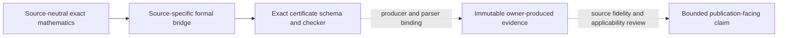
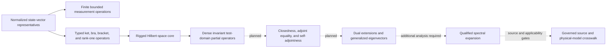

# Formalization roadmap

This roadmap orders work by dependency. It does not authorize implementation, execution, publication, or scientific claims.

## Goal spines

These diagrams show intended direction, not proof status. Solid arrows describe mathematical or
contract flow within a spine; dashed arrows mark planned prerequisites, external evidence flows, or
authority gates. Neither kind of arrow replaces the theorem manifest, a source crosswalk, a checked
certificate, applicability review, or publication authorization. Planned arrows must not be imported
into the generated kernel-dependency graph as though they were Lean implications.

The verification-sidecar spine is:

The current quantum-mechanics direction is:

The manifest records the source-neutral Q0--Q4 layers. Q5--Q8 remain planned: formal-adjoint
containment is not adjoint equality or self-adjointness, and no generalized spectral theorem,
textbook-postulate fidelity claim, runtime binding, or concrete Hamiltonian application follows from
the arrows alone. Actual compiled dependencies remain separately documented in
[`declaration-dependency-graph.md`](declaration-dependency-graph.md).

## R0 — repository contract

Status: complete.

- Authority and evidence boundaries.
- Source and dependency identity.
- Module ownership and conventions.
- Theorem manifest, trusted-base audit, and bounded agent workflow.

## R1 — finite foundations

Status: substantially implemented.

- Metric admissible-set geometry.
- Pointwise Bloch sewing and finite rank-two samples.
- Hilbert-ball and weighted Frobenius geometry.
- Rank-two fields, exact canonical band values, exact complex-unitary spectrum/trace/determinant and lower/upper-band invariance, pointwise band-field invariance, unnormalized Frobenius perturbation bound, spectral decomposition, and correlation optimization.
- Exact finite-rank analytic-parent qualification: nonempty finite-bond structure-factor bounds, selected orbital-coordinate bounds, retained/exterior energy bounds, external gap at least `19/10`, and adjacent retained gap at least `7/(10(r-1))`.

Open:

- immutable owner-commit binding for the provisional Periodic2D/3D rank-N formulas and any runtime-array, NumPy, sampled-gap, or scientific applicability bridge;
- periodic-potential construction;
- quotient-torus and regularity contracts;
- concrete publication-data binding; and
- accepted literature identities.

## R2 — rank-two witnesses and certificates

Status: exact scalar geometry and one source construction implemented.

- Reduced spectral and operator losses.
- Ellipse intersection and exact distance.
- Candidate-rectangle containment transfer.
- Rational-center, center-interval, and joint curvature-correlation checkers.
- Exact Paper A two-observation construction and degenerate-curvature regression.

Open:

- runtime parser and artifact binding;
- calculated four-state-parent certificate;
- periodic-potential construction; and
- structured perturbation results beyond scalar boxes.

## R2.5 — finite Fourier and decisions

Status: generic foundations implemented.

- Finite reconstruction, inversion, Parseval, residual tails, Hermitian pairing, fixed-unitary equivariance, exact equal-weight least-squares optimality and uniqueness of support truncation over a complete uniform finite-abelian inventory, and the exact direct partition of matrix Frobenius power into identity-coefficient and nonidentity-coefficient sums, together with an arbitrary-dimension/arbitrary-rank matrix-Frobenius lattice layer and explicit periodic 1-D, 2-D, and 3-D specializations. The power partition specifies exact onsite/nononsite semantics but does not certify subtraction of separately rounded binary64 totals.
- Positive even centered integer inventories, exact negative-Nyquist singleton removal, full-versus-removed reconstruction, normalized removed-block power independent of later range selection, and symmetric ordinary support below half the mesh size.
- Complete finite metric shells over caller-supplied inventories, including nested cutoffs, exact tie retention, conditional inversion and symmetry-orbit closure, strict block-count growth at every attained radius, no-skipped-attained-shell semantics, and exact square, triangular, simple-cubic, and normalized FCC reduced-coordinate indices; no runtime inventory, physical hopping-range, or material binding is inferred.
- Exact integer-lattice quotient admission: `AB=BC` well-definedness certificates on `ℤ³/Bℤ³`, separately admitted inverse maps, two-sided quotient bijectivity, finite positive diagonal quotients, positive cubic FCC--Bain admission, and the fail-closed mixed-modulus criterion `N₂=N₃ ∧ N₁∣N₂`; no runtime mesh or convergence binding is inferred.
- Exact reference/interpolation/conversion/deliberate-truncation residual decomposition with pointwise, finite-maximum, and finite root-mean-square triangle bounds, plus exact Hilbert and explicit matrix-Frobenius power and root-mean-square Fourier-tail identities and pointwise and finite-maximum ambient-norm tail bounds for the deliberate-truncation channel.
- Exact character-phase mode shifts, trivial pointwise scalar-operator conjugation, coefficient separation, pointwise-unitary Frobenius invariance, the finite matrix-product convolution law, the pointwise-unitary triple-convolution support inclusion `supp(Uᴴ A U) ⊆ (-S_U + S_A) + S_U`, and its complete-shell bound `R_A + 2 R_U` for a supplied inversion-invariant subadditive nonnegative radius. Explicit square, triangular, simple-cubic, and normalized FCC integer-lattice radii now square to the existing shell indices and satisfy the required inversion and triangle laws and instantiate the elementwise and complete-shell inclusion bounds; finite-character quotient wraparound remains a separate binding obligation.
- An explicit rank-two `ZMod 2` witness in which a pointwise swap gauge creates the odd coefficient `diag(1/2,-1/2)` and does not commute with zero-mode truncation.
- An arbitrary-finite-dimensional binary product-mesh lift, with explicit 2-D and 3-D cases, in which exact pointwise Hermiticity and ordered-band equality coexist with exact full Fourier reconstruction, zero-mode-truncation noncommutation, and strictly positive omitted matrix-Frobenius power.
- Rectangular complex frames, ambient projectors, compression/reconstruction, and right-unitary retained-coordinate covariance, including the exact dimension-independent construction `F'=F₀G`, `H'=GᴴDG`, complex-spectrum preservation, and known-inverse frame/operator recovery by `Gᴴ`.
- Exact complex-unitary right Procrustes algebra for `‖candidate * gauge - reference‖_F²`, including the cross matrix `candidateᴴ * reference`, Frobenius/trace expansion, polar-witness global minimality, and uniqueness under an explicit positive-definite factor; no runtime SVD, rank, tolerance, or rank-deficient completion is authenticated.
- A finite-mesh Procrustes hierarchy that sums local objectives, lifts one supplied polar witness per point to pointwise and global minimality, requires positive definiteness at every point for summed uniqueness, compares against constant and identity fields, proves exact known-inverse zero-objective controls, and embeds unitary matrices into the abstract identity/global/complete alignment families; no mesh, runtime witness, optimizer, or certificate is authenticated.
- Separate singleton, identity, global-unitary, and complete pointwise-unitary alignment families with inclusion-based feasibility transfer and explicit strict-separation witnesses.
- Sewn reference-minus-aligned-candidate operator differences with exact recovery and zero criteria, pointwise self-adjointness closure under complete-space and explicit self-adjointness hypotheses, exact action/operator-norm bounds, and same-alignment subtraction and Lipschitz stability.
- Finite dominance, Pareto efficiency, threshold feasibility, minimum cost, and two-channel classification.
- First-passing existence and uniqueness over supplied finite inventories, including one-cutoff joint passage without monotonicity.
- A generic finite spectral--operator compatibility schema with one common candidate, a nonempty alignment family, and an alignment-infimum operator criterion, a stronger one-alignment witness predicate across mandatory operator channels, explicit-attainment bridges, finite central admissible sets, attained compatibility distance under nonemptiness, zero-distance/compatibility and positive-distance/incompatibility equivalences, conformant model-class embeddings, and first-compatible-class selection.
- An exact finite-maximum aligned-operator loss with same-alignment perturbation and budget-headroom bounds, plus an adapter that retains an application-supplied alignment carrier while projecting its pointwise unitary field into the generic witness/central compatibility predicates.
- Precise mandatory operator channels: exact `ENNReal` error values with channel-specific upper budgets, separately typed nonnumeric structural requirements, and a tagged same-candidate/same-alignment adapter into the generic schema.
- A narrow source-neutral four-stage residual adapter with interpolation, conversion, deliberate-truncation, and total finite-maximum error channels, including coordinatewise budget-relaxation monotonicity, explicit component-to-total budget synthesis under a stated total-headroom premise, exact component-level expansions of conformant operator witnesses and witness compatibility, and disjoint composition with consumer-supplied precise error and structural datasets; the narrow adapter carries an empty structural inventory, while composition preserves added obligations without claiming complete study coverage.
- Exact minimizer existence for nonempty finite alignment families, conversion of infimum passage to a concrete budget-feasible alignment, and conditional central/witness compatibility equivalence under a separate minimizer-channel-conformance premise.
- Exact Boolean dominance, threshold, and nondominated-mask checks.
- Conservative accepted/rejected/unresolved checks for outward interval thresholds, joint feasibility at one decision, and first passage over a supplied finite inventory.

Open:

- owner-specific retained-frame, alignment, self-adjointness-hypothesis, and exact/outward operator-norm binding;
- exact or independently checked construction of application-specific Procrustes polar witnesses, with rank-deficient completion policy kept external unless a consumer freezes it;
- matrix-Frobenius maximum-tail specialization after selecting an explicit representation bridge;
- runtime interpolation, evaluation-mesh, and exact/outward-rounded residual-channel bindings;
- an exact owner-specific bridge from NumPy `fft`/`fftshift` and its centered-origin phase convention to the abstract centered inventory and coefficient field;
- source-defined physical hopping-range, external shell-inventory, and publication-mesh bindings beyond the exact source-neutral metric-shell semantics, including a quotient-compatible bridge from finite character modes and centered representatives to the new integer-lattice radii;
- nonuniform weighted Parseval;
- runtime interval serialization, enclosure-production arguments, and external coverage;
- concrete Paper B/C tables; and
- concrete owner-specific error-channel taxonomies and compatibility inventories, verified structural-requirement contracts, heterogeneous candidate-carrier embeddings, cross-gauge stability bridges, and proposition-specific certificate bindings;
- runtime-bound cutoff inventories and later Wannier90 layers;
- exact owner-specific identification of runtime periods, reciprocal-basis coordinates, matrix axes, support, and gauge with the finite-periodic lattice carrier; and
- exact owner-specific identification of a NumPy design with the complete uniform character inventory, plus numerical rank, conditioning, solver, and binary64 route-agreement validation.

The first Ragasa2026b projection proposition is completed as
`BG-PROJECTION-DEF-001` through `011` and `BG-PROJECTION-THM-001` through `008`. The proof
encodes the nearest-neighbor Laurent parent, verifies its scalar square, proves the
source-assumption Laurent square-root obstruction, establishes unit-circle Laurent
uniqueness, verifies the lower-band projector and sandwich identity, and derives the final
matrix-valued non-finite-support conclusion. Later projection questions—quantitative decay,
higher rank, multidimensional parents, and general preservation criteria—remain open.

## R3 — continuum Fourier analysis

Status: normalized finite product-torus factorization and the exact normalized sine-phase `J₀` bridge implemented; broader continuum layer deferred.

Implemented:

- explicit carrier `Dimension → UnitAddCircle` for finite dimension types;
- finite product of standard unit-circle Haar measures and exact total mass one;
- normalized factorization of coordinate-separable complex averages;
- exponential factorization for coordinatewise additive phases; and
- equal-coordinate power laws, including exact 2-D square and 3-D cube corollaries;
- the standard period-one sine coordinate and positive sine phase;
- the normalized one-circle average `J₀(b)`; and
- exact 2-D `J₀(a)²` and 3-D `J₀(2a/3)³` scaling corollaries.

Open:

- source-specific torus coordinate, endpoint, phase, and measure bindings;
- continuum Fourier coefficients, normalization, and Parseval;
- finite-to-continuum hypotheses and quadrature error; and
- projection/alignment/locality consequences.

The exact Bessel identities must not be promoted into a runtime comparator, finite-mesh result, or scientific claim without the missing external bindings and numerical bridges.

## R4 — special functions and tails

Status: zeroth-order full-angle Bessel integral implemented through an attributed local port; broader family deferred.

Implemented:

- full-angle cosine moments and parity;
- termwise exponential integration with a factorial majorant; and
- `∫₀²π exp(i z cos θ) dθ = 2π J₀(z)` for real `z`.

Open:

- full Jacobi--Anger expansions and nonzero-order Bessel identities;
- shell coefficients; and
- factorial or constrained-series tail bounds.

## R5 — publication instantiation

Status: Paper A has conditional bridges and one exact analytic construction; the Paper B namespace remains a placeholder while its first proposition is proved in the reusable projection module; Paper C remains a placeholder.

- Keep reusable theorems in semantic modules.
- Keep runtime evidence, source fidelity, formal status, applicability, and publication status separate.
- Create Paper D only after an audited owner protocol exists.

Detailed plans are under `docs/BandGauge/Papers/`.

## Stop conditions

Stop for review when:

- the source statement or assumptions are ambiguous;
- rank, dimension, scalar field, domain, or alignment family would change;
- a dependency lacks an immutable compatible revision;
- approximate data would be treated as exact without a checker; or
- work requires an owner-repository mutation or protected action.
